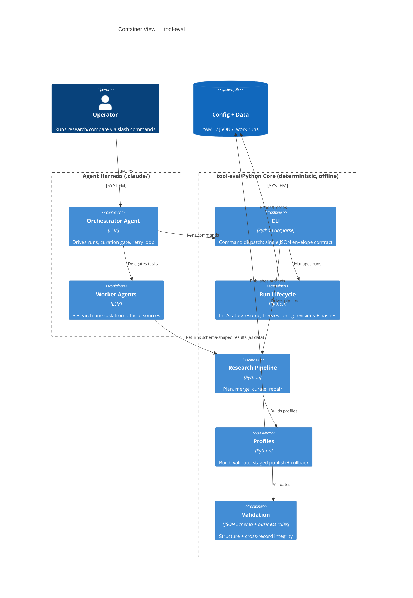
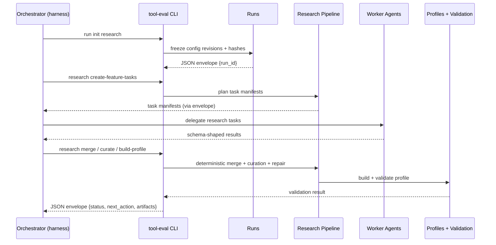

# System Architecture

## Overview
**tool-eval** is a deterministic, offline Python CLI that researches, profiles, and compares AI coding tools. It deliberately separates two concerns: the Python core performs only deterministic work — validation, merging, publication, and run lifecycle management — while all reasoning (research, curation judgement, web access) is delegated to an external agent harness defined under `.claude/` (Claude Code) or `.github/` (GitHub Copilot CLI). Every CLI command emits exactly one JSON envelope to stdout and logs to stderr, making the tool ideal for agent consumption.

## Visual Architecture Context

## Architecture Pattern
**Pattern**: Layered, contract-first CLI built around a run-centric state machine.

The implementation leans toward a hexagonal style: pure logic modules (e.g., `planner.py`, `merge.py`) are separated from filesystem/IO wrappers (e.g., `pipeline.py`) so business logic is testable without touching a filesystem or network. JSON Schemas are the source of truth for data structure; a separate business validator enforces the cross-record rules that JSON Schema cannot express (referential integrity, completeness gates, protocol checklists). Development is decision-log-driven: code, tests, and docs continually cite a shared decision log (D-001…D-023).

## System Structure

### CLI Entry & Contract
- **Location**: `src/tool_eval/cli.py`, `src/tool_eval/__main__.py`
- **Purpose**: argparse command dispatch across groups (`config`, `run`, `research`, `profile`, `compare`, `work`); each command emits a single JSON envelope `{status, code, run_id, next_action, artifacts, errors}`.
- **Key Files**: `cli.py`, `__main__.py`, `errors.py` (structured `ToolEvalError` with `<FAMILY>_<REASON>` codes), `paths.py` (root discovery, runtime dirs, path-safety guarantees).

### Configuration
- **Location**: `src/tool_eval/config/`, `config/*.yaml`
- **Purpose**: Load, hash (sha256), and validate the required config bundle; enforce mandatory integer `revision` on taxonomy/source-policy/profile-sections.
- **Key Files**: `config/loader.py`; config data: `feature-taxonomy.yaml`, `source-policies.yaml`, `profile-sections.yaml`, `freshness.yaml`, `runtime.yaml`, `presentation.yaml`.

### Run Lifecycle
- **Location**: `src/tool_eval/runs/`
- **Purpose**: Manage run init/status/resume-check/fail as a state machine; freeze config revisions + hashes at start to detect drift on resume; enforce failed-run retention (by age/count).
- **Key Files**: `runs/manager.py`, `runs/retention.py`. Runtime artifacts live under `.work/runs` and `.work/failed-runs`.

### Research Pipeline
- **Location**: `src/tool_eval/research/`
- **Purpose**: Plan feature-research bundles, create worker tasks, deterministically merge worker outputs, run the curation gate, and drive a bounded repair loop — enforcing the not-found checklist (D-009) and completeness gate (D-010).
- **Key Files**: `planner.py`, `tasks.py`, `sources.py`, `pipeline.py` (IO wrapper), `merge.py` (pure), `curation.py`, `repair.py`, `task_validation.py`.

### Profiles
- **Location**: `src/tool_eval/profiles/`
- **Purpose**: Build, validate, and publish tool profiles with staged publication, rollback, and recovery.
- **Key Files**: `build.py`, `description.py`, `validate.py`, `publication.py`. Output under `data/profiles/<tool>/{profile.json,description.md}`.

### Validation
- **Location**: `src/tool_eval/validation/`
- **Purpose**: Two-tier validation — schema (structure/type) and business (cross-record, status, referential integrity) rules.
- **Key Files**: `schema.py`, `business.py`, and 11 JSON schemas under `validation/schemas/` (shipped as package data).

### Comparison & Reporting (Increment 3 — stubbed)
- **Location**: `src/tool_eval/comparison/`, `src/tool_eval/reporting/`
- **Purpose**: Build multi-tool comparisons and render self-contained, sanitized HTML. Currently stubs; `compare build` returns `INPUT_NOT_IMPLEMENTED`.

### Harness Integration
- **Location**: `.claude/agents/`, `.claude/skills/` (Claude Code);
  `.github/agents/`, `.github/skills/` (GitHub Copilot CLI).
- **Purpose**: Define the external LLM orchestration that drives the deterministic Python core.
- **Key Files**: `tool-eval-orchestrator.md`, `tool-eval-worker.md`; skills `tool-eval-research`, `tool-eval-compare`, `tool-eval-resume`, `tool-eval-orchestration`.
- **Copilot adapter**: `copilot-tool-eval-orchestrator.agent.md`,
  `copilot-tool-eval-worker.agent.md`, and `copilot-tool-eval-*` skills. Distinct
  IDs avoid collisions with Copilot's discovery of `.claude/` skills.
  The adapter reuses shared research/content rules and Python contracts;
  tool permissions, completion handling, and adapter checkpoints are
  harness-specific. See `docs/copilot-cli-guide.md`.

## Data Flow
1. **Harness** (orchestrator agent) invokes CLI commands to start a run; `runs/manager.py` freezes config revisions + hashes.
2. **research/planner** produces feature-research task manifests; **worker agents** research each task and return schema-shaped results (offline to Python — inputs arrive as data).
3. **research/merge** deterministically combines worker outputs; **curation** gate and **repair** loop enforce protocol and completeness rules.
4. **profiles/build** assembles a validated profile; **validation/schema + business** confirm structure and cross-record integrity.
5. **profiles/publication** stages and publishes artifacts to `data/profiles/` with rollback/recovery on failure.
6. Every step returns a JSON envelope consumed by the harness to decide the `next_action`.

## Component Communication Flow

## External Integrations
None at the Python layer by design — no databases, model SDKs, or network calls. The only "integration" is the external agent harness (`.claude/` or `.github/`), which supplies research inputs as data. Web/model access lives entirely in the harness, never in the Python core.

## Database Schema
No database. Data contracts are defined as JSON Schemas under `src/tool_eval/validation/schemas/` (the authoritative structural source of truth), complemented by business rules in `validation/business.py`.

## Configuration
Configuration is a bundle of revisioned YAML files under `config/`, loaded via `config/loader.py` which computes sha256 hashes and enforces mandatory `revision` integers. Runs freeze these revisions/hashes at start so a later resume can detect drift and refuse to continue on mismatch.

## Deployment Architecture
Distributed as a Python package (src-layout, hatchling build) and invoked as the `tool-eval` console script or `python -m tool_eval`. No containers, servers, or cloud services — execution is local/offline, orchestrated by the agent harness.

---
*Based on codebase analysis performed 2026-07-24*
