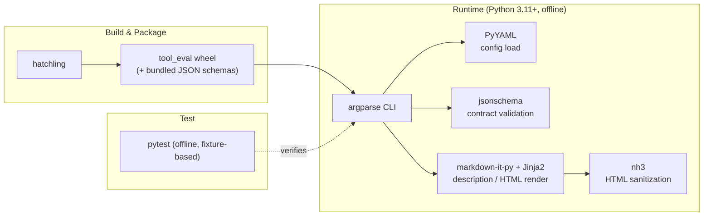

# Technology Stack

## Overview
This document describes the technology choices and rationale for **tool-eval**, the AI Coding Tool Comparison System. The core design principle is a strict split of responsibilities: the Python codebase is **deterministic and offline** (it validates, merges, and publishes data but never calls a model or the network), while all LLM reasoning is delegated to an external agent harness under `.claude/` (Claude Code) or `.github/` (GitHub Copilot CLI). Both adapters use the same Python dependencies and data contracts; see `docs/copilot-cli-guide.md` for the Copilot setup.

## Visual Stack Flow

## Languages

### Python (>= 3.11)
- **Usage**: ~100% of the application source (~2,675 LOC across 29 modules)
- **Rationale**: Rich standard library (argparse, pathlib), strong JSON/YAML ecosystem, and first-class JSON Schema tooling make it ideal for a deterministic data-processing CLI.
- **Key Features Used**: `from __future__ import annotations`, PEP 604 unions (`str | None`), frozen dataclasses for value objects, `pathlib` throughout, structured error codes.

## Frameworks

### Frontend
Not applicable — this is a backend-only CLI tool with no user interface. Presentation output (Increment 3) is generated as self-contained, sanitized HTML rather than a running frontend.

### Backend
No web/application framework. The CLI is built directly on the standard library `argparse`, with grouped subcommands (`config`, `run`, `research`, `profile`, `compare`, `work`), each emitting a single JSON envelope contract to stdout.

### Testing
- **pytest** (`>=8,<9`) — deterministic, offline test suite (~1,417 LOC across 11 modules). LLM/worker inputs are fixture dicts, never live calls; tests run in isolated temp project trees via shared `conftest.py` fixtures.

## Database
Not applicable. tool-eval has no database. State is persisted as files on disk:
- **Data contracts**: JSON Schema (11 schemas, shipped as package data under `validation/schemas/`)
- **Configuration**: revisioned YAML files under `config/`
- **Artifacts**: generated JSON/Markdown under `data/` and runtime state under `.work/runs`

## Build Tools & Package Management
- **Build backend**: `hatchling` / `hatchling.build`
- **Packaging**: src-layout, `packages = ["src/tool_eval"]`; JSON schemas force-included into the wheel so they ship as package data
- **Package management**: pip / editable install (`pip install -e .`); dev extras under `[project.optional-dependencies] dev`

## Infrastructure

### Containerization
None detected.

### CI/CD
None detected — no `.github/workflows`, GitLab CI, or pre-commit hooks currently present. (See improvement opportunities.)

### Hosting
Not applicable — CLI tool distributed as a Python package, not a hosted service.

## Development Tools

### Linting & Formatting
Not currently configured. No `[tool.ruff]`, `[tool.black]`, or equivalent in `pyproject.toml`, despite the codebase being fully and consistently typed. Recommended addition: Ruff + Black.

### Type Checking
Not currently configured. Code is fully type-annotated (PEP 604 unions, `__future__` annotations), so adopting mypy would be low-friction. Recommended addition: mypy.

## Key Dependencies

| Package | Constraint | Role |
|---|---|---|
| `PyYAML` | `>=6,<7` | Load configuration YAML via `yaml.safe_load` |
| `jsonschema` | `>=4,<5` | Validate data contracts against JSON Schemas |
| `Jinja2` | `>=3,<4` | Templating for reporting / HTML generation (Increment 3) |
| `markdown-it-py` | `>=3,<4` | Markdown parsing/rendering of profile descriptions |
| `nh3` | `>=0.2,<1` | HTML sanitization for safe self-contained HTML output |
| `pytest` (dev) | `>=8,<9` | Test framework |

## Version Management
- Project version: `0.1.0` (declared in `pyproject.toml`)
- Dependencies pinned by compatible-range constraints (`>=X,<Y`)
- **No lock file** currently present (no `uv.lock` / `requirements.txt`). Recommended addition for reproducible installs.
- Config files carry an explicit integer `revision`; runs freeze config revisions + sha256 hashes at start to detect drift on resume.

## Migration Path
Not applicable — new project, no legacy migration in progress.

---
*Last Updated*: 2026-07-24
*Auto-detected*: languages, dependencies & versions, build backend, testing framework, absence of linter/type-checker/lock file/CI (all from `pyproject.toml` and codebase inspection). *User-provided*: primary goal (reliable offline research & comparison pipeline).
