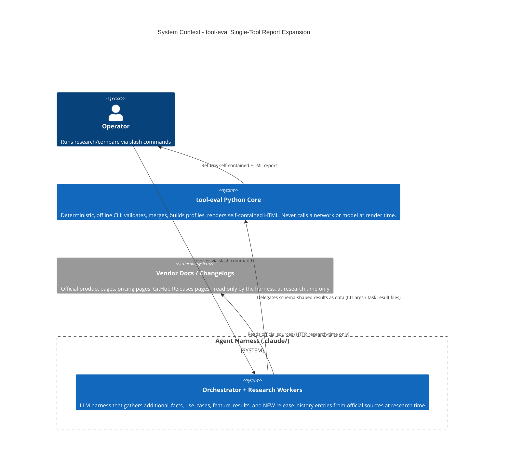
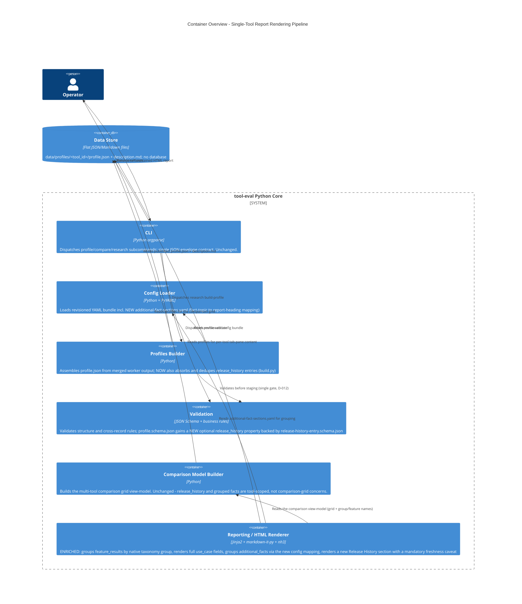
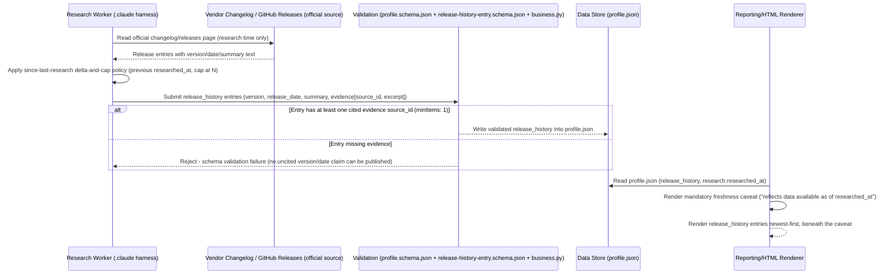

# High-Level Design: Expand Single-Tool Report Content Model

## Design Overview

**Business context**: tool-eval's single-tool report today is a thin tab pane inside the
multi-tool comparison HTML, and it drops most of the data the schema already carries (use-case
rationale/evidence, fact evidence, ungrouped feature results). Operators researching or
demoing one tool cannot see a full picture of it, and there is no changelog/release-history
view at all, even though the underlying vendor data (GitHub Releases, changelogs) is readily
citable.

**Chosen approach**: this is **overwhelmingly a rendering expansion**, not a data-modeling
overhaul. The existing per-tool tab pane in `comparison.html.j2` is enriched in place — no new
template, no new CLI verb, no new render function. `feature_results` are grouped **natively**
by their already-100%-populated taxonomy `group:` field (zero new mechanism); `additional_facts`
are grouped via a **new, revisioned config-mapping file** that follows the project's existing
`feature-taxonomy.yaml`/`profile-sections.yaml` convention exactly. The one genuine schema
addition is a new top-level `release_history` array, structurally parallel to `additional_facts`
but with **mandatory, unconditional evidence** per entry, populated by a research worker under a
since-last-research delta-and-cap policy, and always rendered behind an explicit freshness
caveat. "Known limitations" is deliberately **not** added — the research itself flags an
unresolved sourcing-rigor tension for that section that none of the other four decisions face.

**Key decisions:**
- Enrich the existing tab pane in place (`comparison.html.j2` / `render_comparison_html`) —
  no new template, CLI verb, or output artifact, because no standalone single-tool deliverable
  need is established today.
- Group `feature_results` by their existing taxonomy `group:` field — literally free, no new
  mechanism, no schema change.
- Group `additional_facts` via a new revisioned YAML config file (`additional-fact-sections.yaml`)
  rather than a schema discriminator — matches existing convention, avoids a worker-prompt
  rollout, accepts a manually-maintained mapping table as the trade-off.
- Do not add a "known limitations" section — the sourcing-rigor tension (community/blog claims
  vs. official-sources-only protocol) is a real blocker, not a formality.
- Represent the two "built-in tools" taxonomy gaps as `additional_facts`, not new taxonomy
  features — no stated comparability need justifies the curation-gate/re-research cost yet.
- Add a new, schema-validated `release_history` array with mandatory per-entry evidence and a
  since-last-research population cap — the one place new scope explicitly requires a schema
  change, justified because an unambiguous official source (vendor changelogs) exists.

---

## Architecture

### System Context (C4 Level 1)

The system in focus is the tool-eval Python Core: a deterministic, offline CLI. It never calls
a network or a model at render time. All new content (including `release_history` entries) is
gathered by the external Agent Harness at research time, from official vendor sources, and
handed to the Core purely as data.

The only change at this level relative to today's system is conceptual, not structural: the
harness now also gathers `release_history` facts (from GitHub Releases/changelog pages) using
the same "read official source, hand back schema-shaped data" pattern it already uses for
`feature_results`, `use_cases`, and `additional_facts`. No new external system or actor is
introduced.

### Container Overview (C4 Level 2)

Within the Core, the change touches four containers: Config Loader (new config file),
Profiles Builder (new content channel), Validation (new schema file + referential-integrity
rule), and the Reporting/HTML Renderer (the bulk of the work — richer per-tool rendering). The
CLI and Comparison Model Builder containers are unchanged.

### Release-History Critical Flow (Interaction View)

This sequence isolates the one flow in this design where a correctness guarantee is actually
enforced end-to-end: a `release_history` entry can never reach the rendered report without a
cited official source, and the rendered section can never omit the freshness caveat. It expands
steps 1, 3, and 6 of the Data Flow section above; steps 2, 4, 5 (merge/build, publication,
comparison-grid build) are omitted here since they don't add or check anything new for this
specific flow.

**Open question flagged, not guessed**: the design document does not specify whether a *partial*
worker submission (some entries cited, one missing evidence) fails the whole array or only the
offending entry — `business.py`'s existing referential-integrity loops for `additional_facts`/
`use_cases` operate per-array (a single bad reference fails the whole profile validation), so this
diagram assumes the same all-or-nothing behavior by analogy, but the design doc itself doesn't
state this explicitly and it should be confirmed in the follow-up development task.

---

## Key Components

| Component | Purpose | Responsibilities | Key Interfaces | Dependencies |
|---|---|---|---|---|
| Feature-Group Renderer | Present `feature_results` grouped by their native taxonomy group, per tool | Build a per-tool `{group_name: [feature cells]}` structure from the existing comparison model; render one heading per taxonomy group with status/rationale/evidence/constraints | New helper in `reporting/html.py` feeding `comparison.html.j2`'s per-tool pane | `comparison/model.py`'s existing grouped `ComparisonModel` (no new data needed) |
| Use-Case Renderer | Surface the full `use_case` schema, not just title/kind/description | Render `rationale` and `supporting_features` for `inferred` cases; render `evidence` excerpts for `documented` cases; keep the `kind` badge | Template edit only, `comparison.html.j2:214-221` | `profile["use_cases"]`, source registry (for evidence excerpt lookup, already built by `_sources_by_id`) |
| Additional-Facts Section Mapper | Turn the flat `additional_facts` list into named, scannable sections | Load the new `additional-fact-sections.yaml`; match each fact's `fact_id`/`topic` against the mapping; bucket unmatched facts into an explicit "Other" section | New helper in `reporting/html.py`; consumes `ConfigBundle.files["additional-fact-sections.yaml"]` | Config Loader (new file), existing `additional_facts` array |
| Release-History Renderer | Render the new `release_history` array with an unmissable freshness caveat | Always render the "reflects data available as of `researched_at`" caveat immediately above the section, even for a same-day profile; render each entry's version/date/summary/evidence | Template addition, new section in the per-tool pane | `profile["release_history"]`, `profile["research"]["researched_at"]` |
| Release-History Schema & Validation | Make a version/date claim un-assertable without a citation | New `release-history-entry.schema.json` (mandatory `evidence`, `minItems: 1`, no "inferred" variant); `profile.schema.json` gains the new optional top-level property | JSON Schema `$ref`, `validation/business.py` referential-integrity loop extended to `release_history[*].evidence[*].source_id` | `validation/schema.py`, existing `sources` registry |
| Profile Builder Extension | Absorb `release_history` into the assembled profile the same way `additional_facts`/`use_cases` are absorbed today | Extend `_collect_content` to dedupe `release_history` entries by `release_id`; add the resulting array to the assembled profile dict | `profiles/build.py: _collect_content`, `build_profile` | Profile-writing worker task results (`.claude/` output), same mechanism already used for facts/use-cases |
| Config Loader Extension | Load and freeze the new mapping file exactly like `feature-taxonomy.yaml`/`profile-sections.yaml` | Add `additional-fact-sections.yaml` to `REQUIRED_CONFIG_FILES` with `revision_required=True`; hash and freeze it at run init like every other revisioned config file | `config/loader.py: REQUIRED_CONFIG_FILES`, `runs/manager.py` revision-freeze mechanism | None new — reuses the existing bundle-loading machinery |

---

## Data Flow

1. **Research time (harness, outside the Core)**: a profile-writing worker under `.claude/`
   reads a tool's official documentation, pricing pages, and GitHub Releases/changelog page. It
   produces a schema-shaped task result containing (as today) `additional_facts` and
   `use_cases`, and now also a `release_history` array — releases newer than the previous
   profile's `research.researched_at` (or, for a first-ever research pass, the most recent
   releases up to a cap), each entry citing at least one official `source_id`/excerpt. The two
   "built-in tools" taxonomy-gap concepts (bundled linter/formatter, named sub-agent roles) are
   captured as ordinary `additional_facts` entries with `topic` values the new config mapping
   recognizes.
2. **Merge/build (`profiles/build.py`)**: `_collect_content` is extended to also dedupe
   `release_history` entries by `release_id` (mirroring the existing `fact_id`/`use_case_id`
   dedup). `build_profile` adds `"release_history": content["release_history"]` to the
   assembled profile dict alongside the existing `additional_facts`/`use_cases`/
   `unresolved_issues` keys.
3. **Validation (single gate, D-012)**: `validate_profile` runs the updated
   `profile.schema.json` (structure: the new optional `release_history` array, each item
   validated against `release-history-entry.schema.json`, which makes `evidence` required and
   `minItems: 1` unconditionally — there is no schema-legal way to assert a version without a
   citation). `business.check_referential_integrity` is extended with one more loop, identical
   in shape to the existing `additional_facts`/`use_cases` loops, checking every
   `release_history[*].evidence[*].source_id` against the registered `sources` array. No new
   business rule is needed beyond that — the schema itself already enforces the evidence
   requirement.
4. **Publication**: unchanged — the staged, validated profile (now optionally carrying
   `release_history`) is written to `data/profiles/<tool_id>/profile.json` exactly as
   `additional_facts`/`use_cases` are today. A profile with no discoverable official release
   source simply omits or empty-arrays `release_history` — it is never backfilled from
   unofficial sources.
5. **Comparison build (`compare build`, unchanged)**: `comparison/model.py` builds the
   multi-tool grid exactly as today. `release_history` and the additional-facts groupings are
   tool-scoped rendering concerns, not comparability concerns, so they never touch the
   `ComparisonModel`/flags/scoring machinery.
6. **Render (`render_comparison_html` → `comparison.html.j2`)**: for each tool's tab pane, the
   renderer:
   - looks up that tool's feature-result cells within the already-grouped `model.groups`
     structure (which is grouped by taxonomy `group:` today for the multi-tool grid) and reuses
     that same grouping for the per-tool view — this is the "zero new mechanism" grouping for
     `feature_results`;
   - loads `additional-fact-sections.yaml` (via the config bundle) and buckets that tool's
     `additional_facts` into named sections, with unmatched facts falling into "Other";
   - renders the enriched `use_cases` fields;
   - renders `release_history` (if present) behind the mandatory freshness caveat.
   The output remains one self-contained, sanitized HTML file — no new render function, no new
   template, no new output path.

---

## Integration Points

Exact files touched (design intent only — no code is written as part of this design):

- `src/tool_eval/validation/schemas/profile.schema.json` — add an optional top-level
  `release_history` property (`type: array`, items `$ref` to the new schema file), preserving
  `additionalProperties: false`.
- `src/tool_eval/validation/schemas/release-history-entry.schema.json` **(new file)** —
  `{release_id, version, release_date, summary, evidence}`, with `evidence` `required` and
  `minItems: 1` unconditionally (no conditional branch the way `use-case.schema.json` has for
  `kind`), because a version/date claim has no legitimate uncited form.
- `src/tool_eval/validation/business.py` — extend `check_referential_integrity` with a loop over
  `profile.get("release_history", [])` identical in shape to the existing `additional_facts`/
  `use_cases` loops, checking each `evidence[*].source_id` against `registered_source_ids`.
- `src/tool_eval/profiles/build.py` — extend `_collect_content`'s `_absorb` closure to dedupe
  `release_history` by `release_id`; extend `build_profile`'s assembled profile dict with the
  `release_history` key.
- `config/additional-fact-sections.yaml` **(new file)** — revisioned YAML (top-level integer
  `revision`, like `feature-taxonomy.yaml`/`profile-sections.yaml`) mapping `fact_id`/`topic`
  patterns to report section headings (e.g. "Pricing & licensing", "Security & data handling",
  "Extensibility & MCP ecosystem", "Built-in tools"), with an explicit "Other" fallback.
- `src/tool_eval/config/loader.py` — add `"additional-fact-sections.yaml": True` to
  `REQUIRED_CONFIG_FILES` so it is loaded, sha256-hashed, and revision-tracked exactly like
  every other revisioned config file, and so `runs/manager.py`'s existing freeze-at-run-init
  mechanism covers it (a run should detect drift in the mapping table the same way it detects
  taxonomy drift).
- `src/tool_eval/reporting/html.py` — add small, testable Python helpers (not template-embedded
  logic) that: (a) build the per-tool `{group_name: [feature cells]}` structure from the
  existing `ComparisonModel`; (b) bucket a tool's `additional_facts` using the new config
  mapping; (c) compute the release-history freshness caveat string. `render_comparison_html`
  passes these as new template context variables.
- `src/tool_eval/reporting/templates/comparison.html.j2` — rework the per-tool tab pane
  (`:176-226`) to render the new section structure and ordering (see layout sketch below); no
  other part of the template (comparison grid, KPI row, warnings, footer) changes.
- `src/tool_eval/cli.py`, `src/tool_eval/comparison/model.py` — **unchanged**. No new CLI verb
  (per 1A), no new comparison-grid concept.
- `.claude/` profile-writing skill/worker prompt (harness side, not Python core) — needs a
  content update (out of this design's scope to author, but required before `release_history`
  or the two new `additional_facts` gap entries can actually be populated): teach the worker to
  (a) read the previous profile's `research.researched_at` and cap release capture per the
  since-last-research policy, citing official GitHub Releases/changelog pages; (b) emit
  `additional_facts` entries for bundled-formatter/linter and named-sub-agent-role concepts
  using `fact_id`/`topic` values the new config mapping recognizes.

---

## Rendering Layout Sketch (Per-Tool Tab Pane)

Ordering within one tool's pane in `comparison.html.j2`, top to bottom:

1. **Header** (avatar, name, vendor, freshness badge, homepage) — unchanged.
2. **Description** (existing `description.md` prose sections) — unchanged.
3. **Built-in tools** *(new heading)* — the `agentic_execution` and `workflow_ecosystem`
   taxonomy-group feature_results (the six feature_ids the research identified as "built-in
   tools": `mcp_or_plugin_extensibility`, `multi_agent_orchestration`,
   `terminal_command_execution`, `sandboxed_execution_environment`, `standalone_cli`, plus
   `static_analysis_integration` shown under Context & Code Quality below since it is AI-consumed
   lint integration, not a shipped utility), combined with any `additional_facts` mapped to
   "Built-in tools" (the two taxonomy-gap facts: bundled formatter/linter, named sub-agent
   roles).
4. **Use cases** *(enriched)* — full `title`/`kind` badge/`description`, plus `rationale` and
   `supporting_features` for `inferred` cases, plus `evidence` excerpts for `documented` cases.
5. **Code Authoring & Editing** / **Context & Code Quality** *(native taxonomy-group headings)*
   — the two remaining feature_results groups not already surfaced under "Built-in tools" or
   "Security & data handling"; rendered so no `feature_results` entry is ever dropped from the
   per-tool view.
6. **Pricing & licensing** *(new heading)* — `additional_facts` mapped via the config file (no
   native taxonomy group covers pricing).
7. **Security & data handling** *(new heading)* — the `security_governance` taxonomy-group
   feature_results plus any `additional_facts` mapped to this heading.
8. **Extensibility & MCP ecosystem** *(new heading)* — `additional_facts` mapped via the config
   file, narratively covering MCP/plugin/integration facts alongside (not duplicating) the
   feature-status entries already shown under "Built-in tools".
9. **Release history** *(new section)* — the mandatory freshness caveat ("Release history
   reflects data available as of `{researched_at}`; check the vendor's official channel for
   newer releases") rendered immediately above a list of `{version, release_date, summary,
   evidence}` entries, newest first.
10. **Other facts** *(overflow bucket)* — any `additional_facts` entry the config mapping does
    not recognize, so unmapped facts remain visible rather than silently dropped.

The exact assignment of any individual overlapping `feature_id` (e.g. deciding whether
`mcp_or_plugin_extensibility` is *only* shown under "Built-in tools" or also referenced under
"Extensibility") is an editorial/config detail left to the specification phase — this design
fixes the *mechanism* (native taxonomy-group headings for `feature_results`; config-mapped
headings for `additional_facts`; a fixed, documented section order) not the final per-feature
curation.

---

## Design Decisions

| # | Decision | Outcome | Detail |
|---|---|---|---|
| 1 | How to render a single-tool report at all | Enrich the existing tab pane in place | [ADR-001](decision-log.md#adr-001-enrich-the-existing-tab-pane-in-place) |
| 2 | How to group `feature_results`/`additional_facts` into named sections | Native `group:` field for features; new config-mapping file for facts | [ADR-002](decision-log.md#adr-002-config-mapping-file-for-additional_facts-section-grouping) |
| 3 | Whether to model "known limitations" | Do not add the section now | [ADR-003](decision-log.md#adr-003-defer-known-limitations-section) |
| 4 | How to close the "built-in tools" taxonomy gaps | `additional_facts` only, no taxonomy change | [ADR-004](decision-log.md#adr-004-model-built-in-tools-gaps-as-additional_facts) |
| 5 | How to model and source a changelog/release-history section | New `release_history` schema array, mandatory evidence, since-last-research cap, mandatory freshness caveat | [ADR-005](decision-log.md#adr-005-structured-release_history-array-with-mandatory-evidence-and-freshness-caveat) |

---

## Concrete Examples

**Example 1 — Use case with full fields (Decision 1).** *Given* `cursor`'s profile has a
`use_case` with `kind: inferred`, a `rationale` explaining why it was inferred, and
`supporting_features: [mcp_or_plugin_extensibility]`; *when* the operator opens `cursor`'s tab
in a rendered comparison report; *then* the "Use cases" section shows the title, an "Inferred"
badge, the description, the rationale text, and a reference back to the supporting feature —
not just title/kind/description as today.

**Example 2 — Additional-facts grouping with overflow (Decision 2).** *Given* `github_copilot`'s
profile has facts with topics "Extensibility via MCP" (matches the config mapping's
"Extensibility & MCP ecosystem" entry) and "Free tier limits" (matches "Pricing & licensing"),
plus a new, not-yet-mapped topic "Roadmap notes"; *when* the report renders; *then* the first two
facts appear under their respective named headings, and "Roadmap notes" appears under the
"Other" section — visibly, not silently dropped — signalling that the mapping table needs an
update.

**Example 3 — Release history with freshness caveat (Decision 5).** *Given* `claude_code` was
last researched on 2026-05-01 and a follow-up research pass on 2026-07-25 finds three official
GitHub Releases newer than that date, each with a version, date, and cited changelog excerpt;
*when* the profile is rebuilt and re-rendered; *then* the "Release history" section shows the
caveat "Release history reflects data available as of 2026-07-25T..." immediately above exactly
those three entries, newest first, each with its evidence excerpt — and if a fourth, uncited
release claim were attempted, the profile would fail schema validation before it could be
published.

---

## Out of Scope

- **A standalone, shareable single-tool HTML artifact** (a new `profile show`/`render` CLI verb
  and template) — deferred; the single-tool report remains a tab inside the comparison document.
  Revisit as 1C (shared macro + thin wrapper template) if a concrete export/archival need is
  stated later.
- **A schema discriminator field on `additional-fact.schema.json`** (Decision Area 2's
  Alternative 2B) — deferred as a future upgrade if the config-mapping table proves to need
  frequent, error-prone manual updates.
- **A "known limitations" section** in any form (repurposed `unresolved_issues`, a new schema
  construct, or an `additional_facts` entry) — explicitly out of scope until the
  community/blog-sourcing-rigor tension is resolved as its own, separate decision.
- **Promoting the two "built-in tools" gaps to full taxonomy `feature_id`s** — no
  curation-gate involvement, no re-research of existing profiles in this round.
- **Hardening `additional-fact.schema.json` to require evidence** (matching
  `use-case.schema.json`'s conditional requirement) — a real, code-confirmed structural gap
  noted by the research, but a separate hygiene task, not part of this content-model expansion.
- **Auto-refreshing `release_history` after publication** (a background job re-checking a
  vendor's releases page and silently updating a published profile) — would require a
  network/model call outside the research-time worker path, directly violating the
  deterministic-core constraint. The existing re-research/`profile_state: requires_research`
  cycle is the only sanctioned mechanism for keeping this section current.
- **"Best for X" positioning summaries and independent-benchmark sections** — ranked lowest
  priority in the underlying research and not part of any of the five decisions here.
- **A canonical "recommended `additional_facts` topics" checklist** — a distinct, adjacent idea
  the research flagged but did not fold into this content-model expansion.

---

## Success Criteria

- A tool's rendered tab pane shows `use_case.rationale`/`.supporting_features` (for inferred
  cases) and `.evidence` (for documented cases), not just title/kind/description.
- Every `feature_result` for a tool appears under a named taxonomy-group heading in that tool's
  tab pane; none are visible only via the flat comparison grid or a hover tooltip.
- Every `additional_facts` entry appears under either a named, config-mapped section heading or
  the explicit "Other" bucket — never silently dropped from the grouped view.
- The two "built-in tools" taxonomy gaps (bundled formatter/linter, named sub-agent roles) are
  representable as `additional_facts` today, with no schema or curation-gate change required.
- No "known limitations" content ships in this round; the section is absent, not populated at a
  visibly lower evidentiary bar than the rest of the report.
- A `release_history` entry can never be published without at least one cited, registered
  source — enforced by schema, not convention.
- Every rendered "Release history" section carries the freshness caveat, regardless of how
  recently the tool shipped or was researched.
- All of the above is achieved with zero new CLI verbs, zero new render functions/templates, and
  exactly one new top-level schema property (`release_history`).
